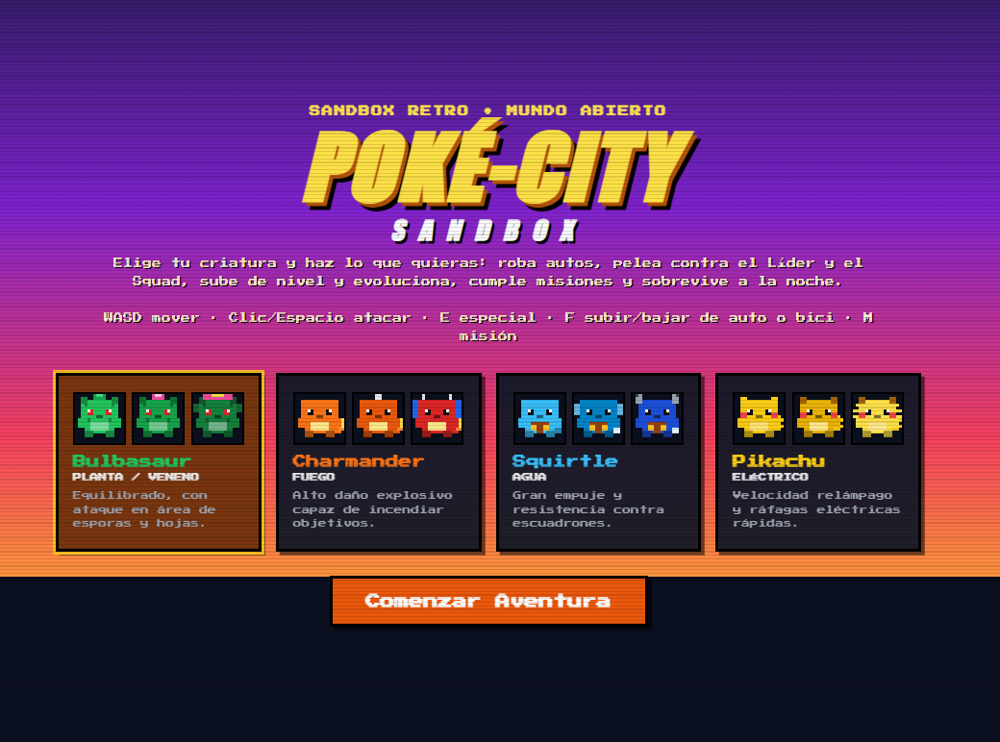

# Poké-City Sandbox

Minijuego web de **mundo abierto** en **pixel art** con vista cenital, mezcla de aventura estilo Pokémon y caos de ciudad estilo GTA: roba autos, esquiva a la policía, cumple misiones, evoluciona y derrota al Líder del gimnasio en su propio gym.



Todo el juego vive en **un solo archivo HTML** (`poke_city_sandbox.html`), sin dependencias ni compilación. Solo la fuente pixel (*Press Start 2P*) se carga desde Google Fonts, y si no hay conexión usa una fuente monoespaciada.

**[Jugar a Poké-City Sandbox](https://luciod3v.github.io/Poke-City-Sandbox/)** (disponible después de activar GitHub Pages).

## Características

### Personajes y evolución
- **4 líneas evolutivas jugables:** Bulbasaur, Charmander, Squirtle y Pikachu, con sprites pixel art propios para cada forma.
- **Evolución al subir de nivel** (Nv. 4 y Nv. 8). Cada forma cambia de aspecto (cuernos, alas, flor, cañones, melena eléctrica) y la forma final tiene aura de chispas.
- La pantalla de selección muestra las 3 evoluciones de cada personaje.

### Ciudad viva
- **Gráficos pixel art:** el juego se dibuja a baja resolución y se escala sin suavizado, con textura de pasto, calles con líneas y cruces peatonales, aceras, farolas, árboles, flores, un lago y edificios con techo, fachada, ventanas y puerta.
- **Ciclo día/noche** de 4 minutos, con reloj junto al minimapa. De noche se encienden farolas, ventanas y faros de los autos.
- **Autos:** tráfico en los carriles y autos estacionados. Puedes robarlos (`F`), conducirlos, chocar, atropellar y hacerlos explotar.
- **Peatones** que caminan, huyen si atacas y quedan KO si los golpeas o atropellas.
- **Bicicleta** para moverte más rápido; si te derrotan, la pierdes y reaparece en su lugar al rato.

### Combate, búsqueda y Squad
- **Sistema de búsqueda (`★`) y `SQUAD`:** el caos sube tu nivel de búsqueda y aparecen patrullas coordinadas.
- **Atropello:** si chocas al Squad o al Líder con un auto a buena velocidad, salen volando, quedan noqueados y reciben daño según tu velocidad.
- **Apuntado:** con mouse apuntas al cursor. Si no usas el mouse, el ataque apunta al enemigo más cercano o hacia donde caminaste por última vez, y siempre se ve una mira.
- **Ataques con forma según el tipo:** rayo (Pikachu), gota de agua (Squirtle), hojas giratorias (Bulbasaur) y bola de fuego (Charmander).
- **Ataques nuevos desbloqueables** con mini-misiones: **Ráfaga** (`Q`) y **Escudo eléctrico** (`R`).

### Historia, NPCs e interiores
- **Trama:** el Líder DRAKE controla Poké-City con su Squad. Hay una intro narrada al empezar por primera vez.
- **NPCs con diálogos** (`F`): Prof. Abedul, Lucía, Don Chato y Rufus, más personajes dentro de las casas. El texto aparece letra por letra.
- **Mini-misiones:**
  - **Lucía:** recoge 3 baterías ⚡ → desbloqueas **Ráfaga**.
  - **Don Chato:** entrega un paquete en el hotel → desbloqueas **Escudo eléctrico**.
- **Interiores:** puedes entrar a las casas y al gimnasio. Dentro de las casas hay NPCs que te curan o te dan dinero.
- **El Líder está dentro del gym:** habla con él y acepta el reto para empezar el combate. Si sales a mitad de pelea, el combate se cancela.

### Niveles del gimnasio y escenarios
- Al derrotar al Líder aparece el cuadro **¡LO LOGRASTE!** con el avance de nivel, la recompensa y el nuevo escenario.
- Cada nivel trae un **Líder más fuerte** (más vida, ataque y velocidad) y el Squad también sube de nivel.
- **3 escenarios:** Pueblo Paleta (pasto), Ciudad Carmín (desierto) y Monte Nevado (nieve). Después del nivel 3 se repiten con un Líder más fuerte.
- **El progreso se guarda** en el navegador (`localStorage`): nivel del gimnasio y misiones.

### Compartir y retar
- El cuadro de victoria tiene **Compartir mi logro**: genera una imagen y usa el menú de compartir del dispositivo. En escritorio ofrece enlaces a X, WhatsApp y Facebook, copiar el mensaje o descargar la imagen.
- El enlace compartido incluye un **reto**: quien lo abre ve «*X te retó a llegar al Nivel N*». Es un reto asíncrono, no en tiempo real.
- Puedes escribir un alias opcional al comenzar. Se guarda únicamente en el navegador y se incluye en el enlace cuando compartes un reto; si lo dejas vacío se usa el nombre de la criatura. Para borrarlo, vacía el campo y comienza una partida.

### Privacidad y estadísticas
- El alias y el progreso se guardan en el navegador del jugador, no en el repositorio ni en una base de datos central.
- Por ahora no se registran visitantes ni tiempo de juego globalmente. GitHub Pages solo sirve archivos estáticos; para esas estadísticas se necesitará configurar un servicio externo y avisar a los jugadores.

### Otros
- **Brújula y marcadores** hacia el objetivo actual (misión activa, Líder o `P.C.`).
- **Misiones contrarreloj** (`M`) y **logros** con recompensas en dinero y XP.
- **Música *chiptune*** con Web Audio API, con botón de silencio.
- **Escritorio y móvil:** teclado y mouse, o cruceta y botones táctiles.

## Cómo ejecutarlo

No requiere instalación ni compilación:

1. Clona o descarga el repositorio:
   ```bash
   git clone <URL_DE_TU_REPOSITORIO>
   cd <CARPETA_DEL_REPOSITORIO>
   ```
2. Abre `poke_city_sandbox.html` en tu navegador (Chrome, Edge, Firefox, Safari) **o** levanta un servidor local:
   ```bash
   python3 -m http.server 8080
   ```
   y visita `http://localhost:8080/poke_city_sandbox.html`.

### Publicar en GitHub Pages

1. Sube estos cambios a la rama `main` del repositorio en GitHub.
2. En **Settings → Pages → Build and deployment**, selecciona **GitHub Actions** como fuente.
3. En **Actions**, ejecuta el workflow **Publicar juego en GitHub Pages** si aún no se ha ejecutado. Los siguientes cambios en `main` se publicarán automáticamente.
4. Cuando termine correctamente, comparte `https://luciod3v.github.io/Poke-City-Sandbox/`. En un fork, usa la URL que aparece en **Settings → Pages**.

Si el repositorio es privado, la disponibilidad de Pages depende del plan de GitHub y la configuración del repositorio.

## Controles

| Acción | Teclado / Ratón | Pantalla / Táctil |
| :--- | :--- | :--- |
| Moverse | `WASD` o `Flechas` | Cruceta `▲ ▼ ◀ ▶` |
| Ataque básico | `Clic izquierdo` o `Espacio` | Botón de ataque principal |
| Ataque especial (8 direcciones) | `E` | Botón `Especial (E)` |
| Ráfaga (tras la misión de Lucía) | `Q` | Botón `RAFAGA` |
| Escudo (tras la misión de Don Chato) | `R` | Botón `ESCUDO` |
| Interactuar: hablar, entrar/salir, subir/bajar de auto o bici, curarse en el P.C. | `F` | Botón central `F` |
| Avanzar diálogo | `F`, `Enter`, `Espacio` o clic en la caja | Tocar la caja |
| Nueva misión | `M` | Botón `Misión (M)` |
| Conducir un auto | `W`/`S` acelerar y frenar, `A`/`D` girar | Cruceta |

## Estructura del código

Todo está en `poke_city_sandbox.html`, con **dos bloques `<script>`**:

1. **Script base:** estado del juego (`state`), personajes y evoluciones (`STARTERS`), edificios, misiones, combate, HUD y audio.
2. **Script de mejoras (al final del archivo):** se carga después del base y **redefine funciones** (`update`, `draw`, `interactAction`, `getAimAngle`, `showToast`…) envolviéndolas. Contiene:
   - Motor pixel art y sprites generados por código (`creature`, `human`, `mk`).
   - Autos, peatones, ciclo día/noche y atropellos.
   - Diálogos y NPCs (`say`, `npcs`), misiones (`Q`) y habilidades (`fan`, `shield`).
   - Interiores (`enterB`, `drawRoom`, `roomStep`) y el combate contra el Líder.
   - Niveles de gimnasio y escenarios (`THEMES`, `applyLevel`, `nextLevel`).
   - Compartir (`makeCard`, `shareWin`).

Los estilos del tema pixel están en un segundo bloque `<style>` dentro de `<head>`.

## Ideas para contribuir

Estas son las ideas pendientes y puntos de partida para quien quiera aportar:

- **Multijugador:** ver a otros jugadores en el mapa y retarlos a duelos en tiempo real. Requiere un servidor o conexiones directas entre navegadores.
- **Mapas más grandes:** hoy la ciudad (`WORLD_W` × `WORLD_H`) está colocada a mano. Agrandarla implica reacomodar edificios, carriles, misiones y la generación de árboles.
- **Más contenido:** más NPCs, misiones y ataques; la tienda y las armas; más escenarios y líderes con ataques propios.
- **Más interiores:** entrar también al P.C., la tienda, el hotel y el casino.
- **Reto en tiempo real** a partir del enlace compartido y un ranking.
- **Pruebas y balance:** dificultad del Líder por nivel, daño de los atropellos y rendimiento en móviles.

**Cómo aportar:** haz un fork, crea una rama, prueba tus cambios abriendo el HTML en el navegador y manda un *pull request* describiendo qué agregaste. Intenta mantener el juego en un solo archivo y sin dependencias.

## Estado del proyecto

Proyecto en desarrollo: las funciones nuevas (interiores, diálogos, niveles, compartir) se probaron poco, así que pueden aparecer errores. Si encuentras uno, abre un *issue* con el navegador y los pasos para reproducirlo.
